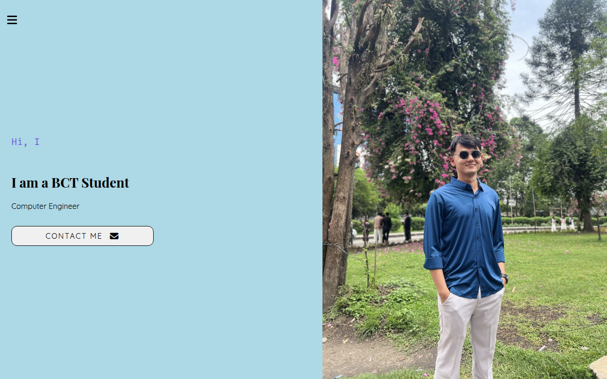

# AWS Bootcamp portfolio

A static portfolio exercise used to practise publishing a website to Amazon S3. It contains a personal introduction, skills and an about section built with HTML and CSS.



## Preview locally

No npm install or build step is required. With Python 3 installed:

```bash
git clone https://github.com/SuhanVerse/AWS_Bootcamp.git
cd AWS_Bootcamp
python3 -m http.server 8000 --directory portfolio --bind 127.0.0.1
```

Open [localhost:8000](http://localhost:8000). The font, icon and typing-animation assets use external services; the page content and styles are local.

## Edit the page

- `portfolio/index.html` contains the content and sidebar behavior.
- `portfolio/css/` contains the section styles and responsive layout.
- `portfolio/img/profile.jpg` is the optimized portrait used by the hero section.

For another portfolio implementation, see [Portfolio_Website](https://github.com/SuhanVerse/Portfolio_Website). This repository keeps the bootcamp exercise.

## S3 workflow

The [AWS_S3 workflow](.github/workflows/main.yml) runs on a push to `main`. It uploads `portfolio/` to the configured bucket's `/portfolio/` prefix using `aws s3 sync --delete`. Files under that destination prefix which are absent locally can be removed.

To use the workflow in your own repository, configure GitHub Actions secrets named `AWS_ACCESS_KEY_ID`, `AWS_SECRET_ACCESS_KEY`, `AWS_REGION` and `S3_BUCKET`, with credentials scoped to the intended bucket/prefix. AWS hosting and credentials are separate from the local preview; no live bucket URL is asserted here.

## License

See [LICENSE](LICENSE).
